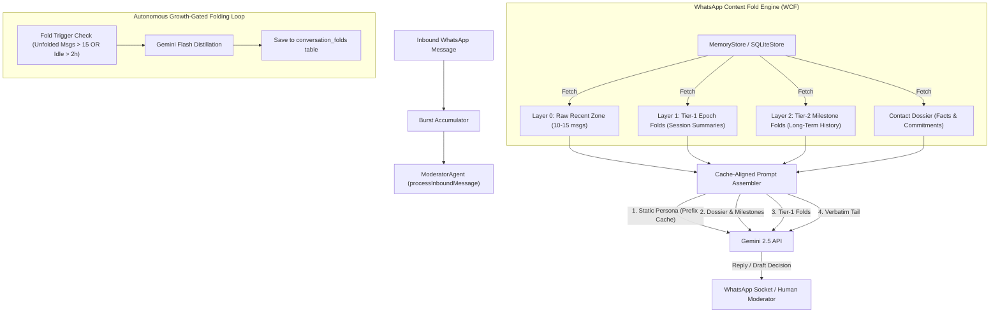

# WhatsApp Context Fold (WCF) Implementation Plan

> **For agentic workers:** REQUIRED SUB-SKILL: Use `superpowers:subagent-driven-development` (recommended) or `superpowers:executing-plans` to implement this plan task-by-task. Steps use checkbox (`- [ ]`) syntax for tracking.

**Goal:** Implement hierarchical, incremental conversation folding (WCF) inspired by `billion-context` (`ranxianglei/billion-context`) in `whatsapp-agent`, enabling months-long customer and personal WhatsApp conversations with zero context window overflow, sub-second latency, and >90% Gemini KV prefix-cache efficiency.

**Architecture:** An LSM-style multi-generational context engine backed by Bun-native SQLite. Contiguous past messages beyond the verbatim recent zone (10–15 messages) are incrementally folded into Tier-1 session blocks and Tier-2 milestone blocks with full message lineage. Prompts sent to Gemini are hierarchically structured to keep the prefix cache intact, supplemented by on-demand decompression and full-text memory search tools.

**Tech Stack:** Bun, TypeScript, SQLite WAL (`bun:sqlite`), Google GenAI / Gemini 2.5 Flash & Pro (`@google/genai`), Vitest / Bun test.

**Spec:** Reverse-engineering breakdown and architectural distillation of `ranxianglei/billion-context` (`acp-kernel`).

---

## Global Constraints

- **Bun-Native Runtime**: All SQLite operations must use `bun:sqlite` with WAL mode; no external ORMs or heavy dependencies.
- **Strict Anti-Slop Discipline**: Zero context pollution — compression prompts, fold tokens, and agent reflections must NEVER leak into raw message storage or customer-facing WhatsApp chats.
- **Zero-Cache-Bust Prefix Invariant**: System prompt and persona must reside as the invariant head of every LLM call to guarantee 90%+ KV cache reuse in Gemini.
- **100% Backward Compatibility**: Existing `ChatMessage`, `ChatSummary`, and `ContactDossier` schemas must remain functional.
- **Fail-Closed Safety**: If folding or memory search fails, fallback safely to the verbatim recent window without interrupting the chat flow.

---

## Review Focus

1. **Epoch Boundary Detection**: Conversations with pauses > 2 hours or turn counts > 15 must cleanly segment into distinct epochs without splitting active back-and-forth bursts.
2. **Lineage Preservation**: Every fold must track `start_message_id`, `end_message_id`, and `direct_message_ids` so any historical agreement can be verified against physical raw messages.
3. **Prompt Cache Stability**: Dynamically generated fold summaries must maintain stable ordering in prompt construction to prevent cache churn across consecutive turns.
4. **Decompress-on-Demand Safety**: When an older quoted message is referenced, only the local bounding window (quoted message ± 2 turns) should be decompressed into context, not the entire historical archive.
5. **Concurrent Burst Resilience**: Rapid inbound WhatsApp bursts must not trigger parallel duplicate folding tasks for the same chat.

---

## User Review Required

> [!IMPORTANT]
> **Gemini Model Choice for Background Folding**:
> By default, the folding worker uses `gemini-2.5-flash` for high-speed, cost-effective background summarization, while the interactive moderator agent continues to use its configured persona model (`gemini-2.5-flash` or `gemini-2.5-pro`).

> [!NOTE]
> **Storage Footprint**:
> Fold blocks are stored in SQLite as lightweight text records (~150-250 tokens per epoch). Even after 10,000 WhatsApp messages, the total fold ledger per chat is typically under 150KB.

---

## Proposed Changes



---

### Component 1: SQLite Storage & Folds Schema

#### [MODIFY] `src/domain/types.ts`
- Define `ConversationFold` type:
  ```typescript
  export interface ConversationFold {
    id: string;
    chatId: string;
    tier: 1 | 2;
    topic: string;
    summary: string;
    startMessageId: string;
    endMessageId: string;
    messageCount: number;
    factsExtracted: string[];
    createdAt: number;
  }
  ```
- Add fold query and retrieval types for context building.

#### [MODIFY] `src/domain/db.ts`
- Add `conversation_folds` table and indexes:
  ```sql
  CREATE TABLE IF NOT EXISTS conversation_folds (
    id TEXT PRIMARY KEY,
    chat_id TEXT NOT NULL,
    tier INTEGER DEFAULT 1,
    topic TEXT,
    summary TEXT NOT NULL,
    start_message_id TEXT NOT NULL,
    end_message_id TEXT NOT NULL,
    message_count INTEGER NOT NULL,
    facts_json TEXT DEFAULT '[]',
    created_at INTEGER NOT NULL
  );
  CREATE INDEX IF NOT EXISTS idx_folds_chat_tier ON conversation_folds(chat_id, tier, created_at);
  ```
- Implement CRUD methods: `saveFold()`, `getFolds(chatId, tier?, limit?)`, `getFold(id)`, `getUnfoldedMessages(chatId, keepRecentCount)`.
- Add full-text search capability for messages and fold summaries.

#### [MODIFY] `src/domain/memory-store.ts`
- Expose fold operations to the domain layer:
  - `saveFold(fold: ConversationFold): void`
  - `getFolds(chatId: string, limit?: number): ConversationFold[]`
  - `searchMemory(chatId: string, query: string): { folds: ConversationFold[]; messages: ChatMessage[] }`

---

### Component 2: Context Fold Engine

#### [NEW] `src/domain/context-fold-engine.ts`
- Implements the demand-driven Growth-Gated folding logic:
  - `shouldFold(chatId: string): Promise<boolean>`: checks if uncompressed history exceeds threshold (e.g. >15 messages or session idle time >2 hours).
  - `foldChatIncrement(chatId: string): Promise<ConversationFold | null>`:
    1. Identifies the compressible slice (older messages outside the protected recent zone).
    2. Invokes Gemini Client via transient distillation prompt (extracts concise summary + verified facts/commitments).
    3. Persists the new `ConversationFold` (Tier-1).
    4. Updates `ContactDossier` with newly confirmed facts without duplicate entries.
  - `coalesceTier1Folds(chatId: string): Promise<ConversationFold | null>`: merges 5+ older Tier-1 folds into a compact Tier-2 Milestone block.

---

### Component 3: Prompt Architecture & Cache Alignment

#### [MODIFY] `src/ai/moderator-agent.ts`
- Restructure `processInboundMessage()`:
  - Fetch recent verbatim zone (10–12 messages).
  - Fetch active Tier-1 & Tier-2 folds via `memoryStore.getFolds(chatId)`.
  - Assemble the structured context prompt adhering to the strict prefix-cache invariant:
    1. **Anchor 1 (Invariant Prefix)**: System Prompt, Persona, and Behavioral Policy.
    2. **Anchor 2 (Long-term Context)**: Dossier facts, commitments, and Tier-2 Milestone Folds.
    3. **Anchor 3 (Mid-term Context)**: Tier-1 Epoch Folds (`[أرشيف المحادثة السابقة: ...]`).
    4. **Anchor 4 (Short-term Tail)**: Recent Verbatim Messages.
    5. **Anchor 5 (Immediate Trigger)**: Incoming message and swiped/quoted context.
  - Wire non-blocking background check `contextFoldEngine.triggerFoldCheck(chatId)`.

---

### Component 4: Decompress & Memory Search Tools

#### [MODIFY] `src/mcp/server.ts`
- Register new MCP tools:
  - `whatsapp_search_chat_memory`: search both fold summaries and raw historical messages by keyword.
  - `whatsapp_get_chat_folds`: list historical conversation epochs and milestone summaries.
  - `whatsapp_decompress_fold`: expand a specific historical epoch into its constituent raw messages.

#### [MODIFY] `src/server/api.ts`
- Expose REST endpoints for UI and client inspection:
  - `GET /api/chats/:id/folds`: return all conversation folds for a chat thread.
  - `POST /api/chats/:id/fold-now`: trigger manual fold generation.

---

## Verification Plan

### Automated Tests
1. **Database Schema & Fold CRUD**:
   - `bun test tests/db.test.ts`: verify `conversation_folds` table creation, indexing, insertion, and range queries.
2. **Context Fold Engine Unit Tests**:
   - `bun test tests/context-fold.test.ts` (NEW):
     - Test threshold detection (uncompressed message count > threshold).
     - Test idle-time detection (gap > 2 hours).
     - Test protected recent zone immunity (last 10 messages never folded).
     - Test fact extraction and dossier synchronization.
3. **Moderator Agent Integration**:
   - `bun test tests/moderator-agent.test.ts`:
     - Verify prompt includes both fold summaries and recent messages.
     - Verify long-range quoted message resolution with folded context.
4. **Full Test Suite Gate**:
   - `bun test`: all 31 existing tests + new fold tests must pass green (100% pass rate).

### Manual Verification
1. Run `bun run cli simulate "إيه اللي كنا اتفقنا عليه بخصوص الأسعار الأسبوع اللي فات؟"` and inspect agent reasoning trace.
2. Open Web UI at `http://localhost:3000` and inspect chat thread headers for active fold summaries and memory depth indicators.

---

## Implementation Tasks

- [ ] **Task 1: Domain Types & SQLite Schema Migration**
  - [ ] Add `ConversationFold` interface to `src/domain/types.ts`.
  - [ ] Add `conversation_folds` table and indices to `src/domain/db.ts`.
  - [ ] Add CRUD methods in `SqliteStore` and `MemoryStore`.
  - [ ] Add unit tests in `tests/db.test.ts` and verify.

- [ ] **Task 2: Context Fold Engine Implementation**
  - [ ] Create `src/domain/context-fold-engine.ts`.
  - [ ] Implement epoch boundary detection (count threshold + idle duration).
  - [ ] Implement transient Gemini distillation prompt for fold generation.
  - [ ] Implement Tier-1 and Tier-2 hierarchical folding.
  - [ ] Create unit tests in `tests/context-fold.test.ts` and verify.

- [ ] **Task 3: Moderator Agent Prefix-Cache Alignment**
  - [ ] Update `src/ai/moderator-agent.ts` prompt builder to include hierarchical folds.
  - [ ] Add background fold triggering upon message completion.
  - [ ] Update `tests/moderator-agent.test.ts` to assert fold context inclusion.

- [ ] **Task 4: MCP Tools & REST API Endpoints**
  - [ ] Add `whatsapp_search_chat_memory` and `whatsapp_get_chat_folds` tools in `src/mcp/server.ts`.
  - [ ] Add `/api/chats/:id/folds` endpoint in `src/server/api.ts`.
  - [ ] Verify via `tests/mcp-server.test.ts` and `tests/engine-integration.test.ts`.

- [ ] **Task 5: Full Suite Regression Pass & GitHub Push**
  - [ ] Run full test suite: `bun test`.
  - [ ] Build production assets: `bun run build`.
  - [ ] Commit and push directly to GitHub.
