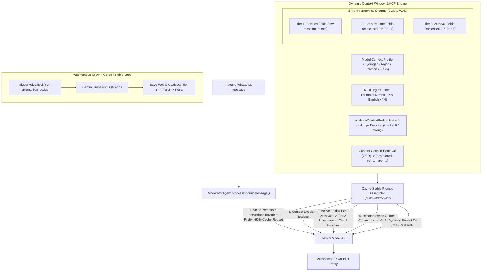

# Dynamic Context Window & ACP Context Compression Architecture

Inspired by `ranxianglei/billion-context` (`acp-kernel`), this document outlines the architecture for dynamic context window budgeting, multi-tier LSM context folding, and Content-Cached Retrieval (CCR) in `fable-agentic-whatsapp`.

## 1. Architectural Overview

## 2. Key Components

### 2.1 Model-Aware Context Profiles & Token Estimation
- Fast Responders (`gemini-4-hydrogen`): 16,000 target budget, 45% soft threshold.
- Balanced Conversationalists (`gemini-4-argon`, `gemini-3.8-flash`): 32,000 target budget.
- Deep Reasoners (`gemini-4-carbon`, `gemini-1.5-pro`): 64,000 target budget.
- Multi-lingual token estimation accounts for Arabic morpho-syntactic density (~2.8 chars per token) vs Latin script (~4.0 chars per token).

### 2.2 3-Tier Multi-Generational LSM Compression
1. **Tier 1 (Session Fold)**: Compresses raw WhatsApp message bursts when count exceeds threshold or when session idle time exceeds 2 hours.
2. **Tier 2 (Milestone Fold)**: Coalesces 3 to 5 Tier-1 session folds into cohesive milestone agreements (pricing, terms, commitments).
3. **Tier 3 (Archival Milestone Fold)**: Coalesces older Tier-2 milestones into high-density historical memory blocks with full end-to-end lineage tracking (`directMessageIds`, `sourceFoldIds`). Older superseded folds are automatically excluded from prompts.

### 2.3 Content-Cached Retrieval (CCR)
- For oversized message payloads (>600 characters) such as long voice note transcriptions, raw document excerpts, or large tool responses, CCR replaces the inline payload in prompts with a deterministic reference tag:
  `[acp-stored: ref="ccr:<hash>" type="audio_transcription" size=1250 chars | preview="..."]`
- The raw text remains safely persisted in SQLite and can be decompressed on demand.

### 2.4 Lossless Decompress-on-Demand
- When a contact replies by swiping/quoting an older message that has been folded away, `buildFoldContext` detects that the message ID is inside an archival fold and dynamically expands a local window (±2 messages around the target) as explicit quoted context.

### 2.5 MCP & REST Interfaces
- MCP Tools:
  - `whatsapp_get_context_status`: Returns current dynamic budget, token usage, compression ratio, active folds count per tier, and nudge recommendations.
  - `whatsapp_compress_context_now`: Triggers immediate active context pruning and hierarchical folding.
  - `whatsapp_get_chat_folds`: Query fold hierarchy with optional tier filtering (`tier: 1 | 2 | 3`).
  - `whatsapp_search_chat_memory`: Keyword and semantic search across raw messages, folds, and CCR content.
  - `whatsapp_decompress_fold`: Unpacks raw messages from any fold.
- REST API:
  - `GET /api/chats/:id/context-status`
  - `POST /api/chats/:id/fold-now`
  - `GET /api/chats/:id/folds`
  - `GET /api/chats/:id/memory-search`
  - `GET /api/chats/:id/folds/:foldId/decompress`

### 2.6 Cockpit UI Integration
- Live Dynamic Context Window & ACP badge in `ChatThread.tsx` header displaying compression percentage.
- Interactive modal showing:
  - Token gauge (current tokens / target budget)
  - Tokens saved & compression ratio
  - Tier breakdown (Tier 1 Sessions, Tier 2 Milestones, Tier 3 Archivals)
  - "Fold Now" action button
  - Memory search bar querying historical messages and summaries.
