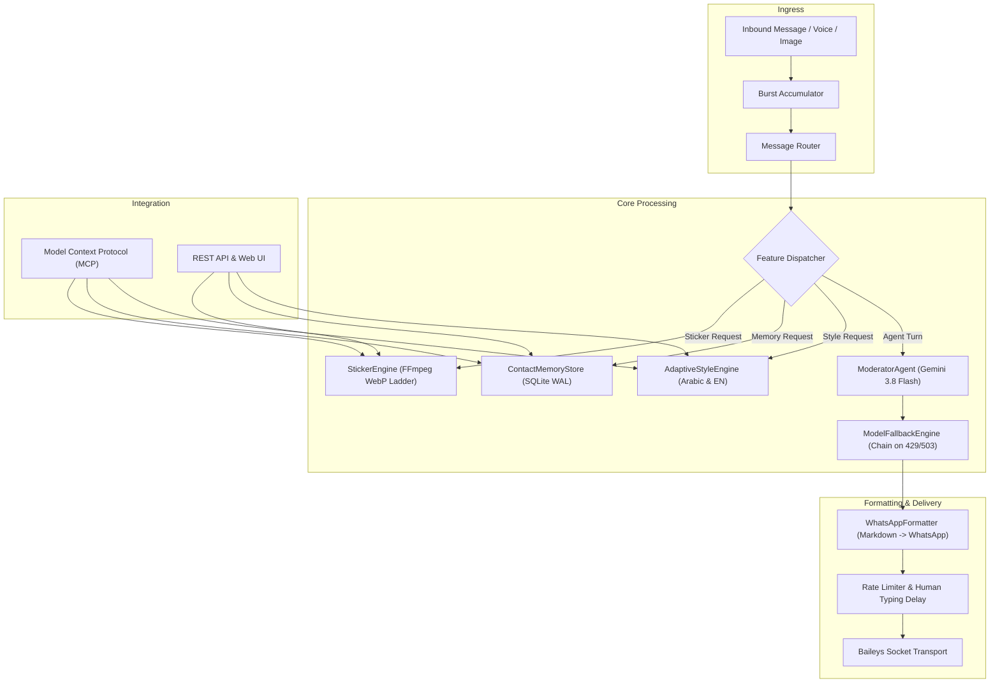

# Replica Architecture: Matured Enterprise WhatsApp Capabilities

## 1. System Overview & Invariants

This specification defines the architectural maturation of consumer capabilities inspired by `illhammf/friday-ai` into the enterprise `fable-agentic-whatsapp` platform.

### Architectural Invariants:
1. **The Browserless Invariant**: All WhatsApp protocol communication operates exclusively over raw WebSockets via Baileys and the Noise Protocol. Zero Chromium or Puppeteer processes.
2. **The 100KB WhatsApp Sticker Invariant**: Any generated WhatsApp sticker WebP buffer MUST NOT exceed 100KB (`102,400` bytes). The FFmpeg transcode engine enforces a deterministic multi-step compression ladder.
3. **The Zero-Credential Persistence Invariant**: User memory storage strictly intercepts and rejects any input matching passwords, API keys, OTPs, auth tokens, secrets, or credit card patterns with a descriptive security exception.
4. **The Model Fallback Safety Invariant**: The model fallback engine intercepts transient errors (429, 503, 500, 404) and advances through configured backup models, but MUST FAIL CLOSED immediately without fallback on authentication errors (401, 403) to prevent silent misconfiguration.
5. **The Tenant & JID Isolation Invariant**: Contact memories and style preferences are strictly partitioned by `brand_id` and contact JID. Group chats are prevented from reading or writing private contact memories.

---

## 2. Module Specifications



### Module 1: WhatsApp Native Formatter (`src/domain/whatsapp-formatter.ts`)
* **Purpose**: Transforms Markdown syntax into WhatsApp-compatible markup.
* **Rules**:
  - `**bold**` -> `*bold*`
  - `_italic_` or `*italic*` -> `_italic_`
  - `~strike~` or `~~strike~~` -> `~strike~`
  - `# Header` -> `*Header*`
  - Strips horizontal rules `---`, `***`
  - Converts Markdown tables (`| Col1 | Col2 |`) into structured bullet lists (`• Col1: Val1 | Col2: Val2`)
  - Converts links `[Label](url)` into `Label (url)`
  - Preserves triple-backtick code blocks and inline backticks.

### Module 2: Resilient Model Fallback Engine (`src/ai/model-fallback.ts`)
* **Purpose**: Prevents service dropouts when Gemini API quotas or regional limits are encountered.
* **Signature**:
  ```typescript
  export async function executeWithModelFallback<T>(
    models: string[],
    invoker: (model: string) => Promise<T>,
    options?: {
      onFallback?: (failedModel: string, nextModel: string, error: unknown) => void;
      circuitBreakerThreshold?: number;
    }
  ): Promise<{ result: T; activeModel: string; attempts: number }>;
  ```
* **Error Classification**:
  - `isFallbackEligible(error)`: Status 429, 500, 502, 503, 504, `RESOURCE_EXHAUSTED`, `UNAVAILABLE`, `model not found`.
  - Fatal: Status 401, 403, `PERMISSION_DENIED`, `INVALID_ARGUMENT`.

### Module 3: WhatsApp Sticker Engine (`src/media/sticker-engine.ts`)
* **Purpose**: Creates high-quality WhatsApp stickers under 100KB with optional text captions and smart cropping.
* **Constraints**:
  - Allowed inputs: `image/jpeg`, `image/png`, `image/webp`, `image/gif`.
  - Max input size: 20MB.
  - Max sticker size: 101,888 bytes (`100KB - 512B`).
  - Text caption: Max 80 characters, max 5 lines, safe character escaping for FFmpeg `drawtext`.
  - Compression ladder: 6 discrete attempts varying canvas size (512, 384, 320, 256) and WebP quality (78 down to 35).
  - Lifecycle: Guaranteed temp file cleanup with `finally` block.

### Module 4: Contact Memory Store (`src/domain/user-memory.ts`)
* **Purpose**: Allows users and agents to store, retrieve, delete, and clear explicit preferences and profile facts.
* **Schema Addition in `src/domain/db.ts`**:
  ```sql
  CREATE TABLE IF NOT EXISTS contact_memories (
    id TEXT PRIMARY KEY,
    brand_id TEXT NOT NULL,
    jid TEXT NOT NULL,
    content TEXT NOT NULL,
    created_at INTEGER NOT NULL
  );
  CREATE INDEX IF NOT EXISTS idx_contact_memories_jid ON contact_memories(brand_id, jid);
  ```
* **Security & Invariants**:
  - Rejects credentials matching `/\b(?:password|passwd|otp|token|api[_-]?key|secret|pin|cvv|credit[_-]?card)\b/i`.
  - Max 30 memories per contact.
  - Max 500 characters per memory entry.
  - Bilingual intent parser: parses Arabic ("افتكر اني...", "امسح الذاكرة رقم...") and English ("remember that...", "delete memory #...").

### Module 5: Adaptive Style Engine (`src/ai/adaptive-style.ts`)
* **Purpose**: Classifies and injects conversational tone dynamically.
* **Styles**:
  - `professional` / `formal` (رسمي / مهني)
  - `casual` (عادي / عامي / ودود)
  - `playful` (مرح / هزار / فكاهي)
  - `assertive` (حاسم / مباشر / جاد)
  - `empathetic` (داعم / متعاطف)
* **Negation Handling**:
  - Direct regex evaluation ensuring "متكنش رسمي" or "don't be formal" does not trigger formal mode.
* **Prompt Directive**:
  - Generates clear, non-tautological instruction to append to `ModeratorAgent` prompt.

---

## 3. Integration Matrix

| Interface | New Capabilities Registered |
|:---|:---|
| **MCP Server** | `whatsapp_create_sticker`, `whatsapp_manage_memory`, `whatsapp_set_chat_style` |
| **REST API** | `POST /api/media/sticker`, `GET/POST/DELETE /api/contacts/:jid/memories`, `POST /api/chats/:jid/style` |
| **UI Components** | `MemoryManagerPanel`, `StickerPreviewModal`, `StyleBadge` |
