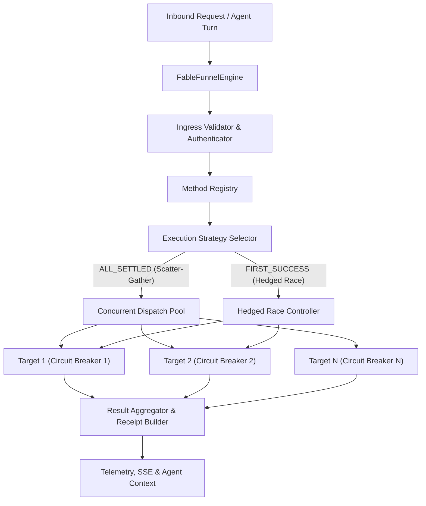

# Replica Architecture: Fable Agentic Funnel Engine

## 1. System Overview & Invariants

The **Fable Agentic Funnel Engine** is a high-throughput, fault-tolerant Scatter-Gather and Hedged Request dispatcher engineered for AI Agent workflows and WhatsApp automation.

### Invariants:
1. **The Isolation Invariant**: Target failures never crash the caller. Each target operates in an isolated promise boundary.
2. **The Fast-Fail Invariant**: Tripped circuit breakers reject execution immediately (0ms overhead) without making network calls.
3. **The Hedged-Race Invariant**: In `RACE_FIRST_SUCCESS` mode, the engine returns as soon as the first healthy response lands, immediately aborting pending requests via `AbortController`.
4. **The Auditability Invariant**: Every dispatch produces a deterministic, cryptographically traceable execution receipt with millisecond timing, status codes, and error codes.
5. **Zero-Slop Boundary**: Strict typing, no `any`, zero unhandled exceptions, zero secret leaks in log lines.

---

## 2. Component Architecture



---

## 3. Data Model & Contracts

### Method Target Definition
```typescript
export interface FunnelTarget {
  id: string;
  name: string;
  url: string;
  method?: 'GET' | 'POST' | 'PUT';
  headers?: Record<string, string>;
  timeoutMs?: number;
  weight?: number;
  retries?: number;
  authHeader?: string;
  enabled: boolean;
}
```

### Funnel Method Config
```typescript
export type FunnelExecutionMode = 'ALL_SETTLED' | 'FIRST_SUCCESS' | 'QUORUM';

export interface FunnelMethodConfig {
  method: string;
  description: string;
  mode: FunnelExecutionMode;
  targets: FunnelTarget[];
  timeoutMs: number;
  circuitBreakerThreshold?: number;
  circuitBreakerCooldownMs?: number;
  quorumCount?: number;
}
```

### Execution Receipt
```typescript
export interface TargetResult {
  targetId: string;
  targetName: string;
  url: string;
  statusCode: number;
  durationMs: number;
  success: boolean;
  data?: unknown;
  error?: string;
}

export interface FunnelReceipt {
  traceId: string;
  method: string;
  mode: FunnelExecutionMode;
  startedAt: string;
  totalDurationMs: number;
  success: boolean;
  successfulCount: number;
  failedCount: number;
  results: TargetResult[];
  winningTargetId?: string;
}
```

---

## 4. API Specification

| Method | Path | Auth | Description | Flow |
|:---|:---|:---|:---|:---|
| `POST` | `/api/funnel/dispatch` | Bearer/API Key | Execute scatter-gather or hedged dispatch for a method | Agent/External |
| `GET` | `/api/funnel/methods` | Public/Read | List registered funnel methods and targets | UI/Inspector |
| `POST` | `/api/funnel/methods` | Admin Token | Register or update a funnel method | System Config |
| `GET` | `/api/funnel/stats` | Public/Read | Live circuit breaker states and execution stats | Dashboard |
| `POST` | `/api/funnel/circuit-breaker/reset` | Admin Token | Manually reset a tripped circuit breaker | Operator |

---

## 5. Failure Modes & Mitigations
1. **Slow Upstream Target**: Mitigated by per-target `AbortSignal.timeout(ms)` to avoid resource starvation.
2. **Cascading Downtime**: Mitigated by per-target Circuit Breakers with 3 states (`CLOSED`, `OPEN`, `HALF_OPEN`).
3. **Thundering Herd**: Mitigated by exponential backoff with randomized jitter on retries.
4. **Duplicate Execution**: Idempotency keys (`X-Idempotency-Key`) stored in memory buffer.
