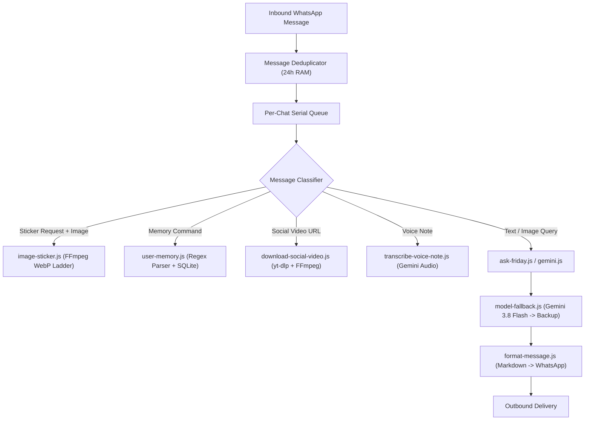

# Replica Recon: illhammf/friday-ai

## 1. Provenance & Cryptographic Evidence Ledger

* **Target Repository**: `https://github.com/illhammf/friday-ai`
* **Maintainer / Author**: Ilham Firmansyah (`@illhammf`)
* **License**: MIT License
* **Target Commit**: `c4302c746b02436630f3b805fd12051d9eeff161` (Nov 4, 2026)
* **Analyzed Repository Files**: 55 files, 13,191 lines of code & tests
* **Runtime Requirements**: Node.js >= 24, `@google/genai` (v2.30.0), `whatsapp-web.js` (v1.34.7), `ffmpeg` 8+, `yt-dlp`

### Hash Audit of Core Modules:
| File | Size (Bytes) | Role & Capability |
|:---|:---|:---|
| `src/index.js` | 42,880 | Central event dispatcher & message router (1,058 lines) |
| `src/ai/user-memory.js` | 5,230 | Explicit user memory parsing, regex filtering & prompt injection |
| `src/ai/conversation-style.js` | 7,120 | Adaptive tone detection (casual, playful, assertive, romantic) |
| `src/ai/model-fallback.js` | 2,190 | Fallback chain on 429/503/RESOURCE_EXHAUSTED |
| `src/whatsapp/format-message.js` | 3,180 | Markdown normalization into WhatsApp syntax |
| `src/whatsapp/image-sticker.js` | 9,925 | WebP sticker creation with compression ladder & drawtext captions |
| `src/video/download-social-video.js` | 8,410 | TikTok / Instagram public video download via yt-dlp & ffmpeg |
| `src/audio/generate-voice-note.js` | 2,840 | Text-to-speech voice note synthesis with text fallback |

---

## 2. Inferred Behavioral Contract & System Topology

### Core Behavioral Flows:
1. **Flow F01: WhatsApp Sticker Generation (`image-sticker.js`)**
   - User sends an image with caption e.g. "buat stiker", "make sticker", or quotes an image.
   - Verifies MIME (`jpeg`, `png`, `webp`, `gif`), caps source at 20MB.
   - Runs `ffmpeg` through an adaptive 6-step compression ladder (`512px @ q78` down to `256px @ q35`) to guarantee output `< 100KB` (WhatsApp limit).
   - Supports center-crop and `drawtext` text overlay with safe escaping.
2. **Flow F02: Explicit User Memory (`user-memory.js`)**
   - User explicitly requests: `save`, `list`, `delete #N`, `clear`.
   - Security gate: intercepts passwords, API keys, OTPs, PINs, secret tokens.
   - Injects memory as untrusted passive context into model prompt.
3. **Flow F03: Conversation Style & Tone Modulation (`conversation-style.js`)**
   - Analyzes user utterance and conversation history for tone keywords (`playful`, `romantic`, `assertive`, `casual`).
   - Applies negation checks (`jangan bercanda` -> NOT playful).
   - Injects system prompt directives for the chosen persona.
4. **Flow F04: Resilient Model Fallback Chain (`model-fallback.js`)**
   - Chains primary model to configured backup models.
   - Detects 429 quota exhaustion, 503 unavailable, 500 server error, 404 missing model.
   - Rejects fallback on auth errors (401/403) to prevent silent credential misconfiguration.
5. **Flow F05: WhatsApp Markdown Formatter (`format-message.js`)**
   - Converts standard Markdown into WhatsApp-safe syntax:
     - `**bold**` -> `*bold*`
     - `# Header` -> `*Header*`
     - Markdown tables -> Bullet list key-value pairs
     - `[link](url)` -> `link (url)`
     - Strips blockquotes and raw HTML.

---

## 3. Critical Architectural Flaws & Anti-Patterns in Friday AI

1. **Heavyweight Browser Dependency**:
   - Relies on `whatsapp-web.js` running headless Chromium via Puppeteer.
   - Consumes 600MB–1.2GB RAM, slow initialization (30s+), frequent disconnection on session timeouts, high detection risk by WhatsApp anti-bot heuristics.
2. **Monolithic Procedural Entrypoint**:
   - `src/index.js` is 1,058 lines of mixed concerns: socket handlers, database calls, Gemini API calls, media conversions, CLI printing.
3. **Hardcoded Locale & Monolingual Regexes**:
   - All memory and style regexes are Indonesian-specific (`ingat`, `hapus`, `bercanda`, `marah`).
4. **No Enterprise Governance & No Human-in-the-Loop**:
   - Lacks Autopilot / Copilot approval gates, draft states, or multi-tenant brand isolation.
5. **Lack of Agentic Extensibility**:
   - No Model Context Protocol (MCP) server; external AI clients cannot invoke Friday's tools.

---

## 4. Maturation Target for Our App (`fable-agentic-whatsapp`)

Our app already possesses:
- Ultra-lightweight `@whiskeysockets/baileys` browserless WebSocket transport (~80MB RAM).
- Enterprise SQLite WAL store with multi-tenant brand isolation.
- Model Context Protocol (MCP) server.
- Reactive Bilingual React + Tailwind UI.
- Scatter-gather Funnel Engine.

### Transferred & Matured Capabilities:
| Friday AI Capability | Our Enterprise Maturation (`whatsapp-agent`) |
|:---|:---|
| `format-message.js` | `WhatsAppFormatter`: Bilingual, table converter, zero-slop Markdown translator. |
| `model-fallback.js` | `ModelFallbackEngine`: Quota circuit breaker, telemetry receipts, ADC + API Key support. |
| `image-sticker.js` | `StickerEngine`: FFmpeg WebP ladder, Arabic & English captions, smart crop, MCP tool + REST API. |
| `user-memory.js` | `ContactMemoryStore`: SQLite-backed, contact & brand scoped, credential interception, MCP tool. |
| `conversation-style.js`| `AdaptiveStyleEngine`: Bilingual (Arabic + English) tone classifier with prompt injection. |
