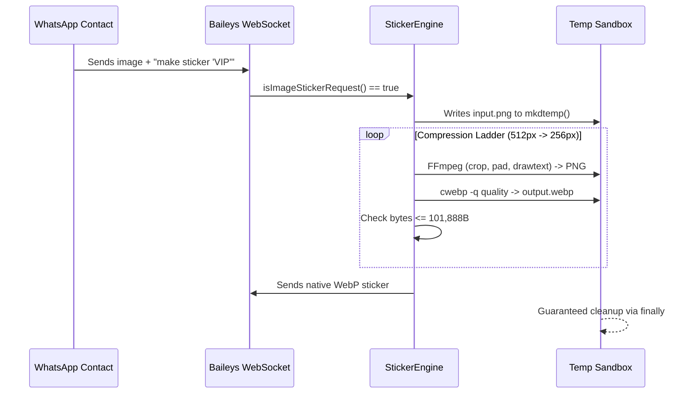

# WhatsApp Friday Assistant: Operational Skill

> Enterprise-grade WhatsApp agent operation combining the responsiveness of browserless WebSockets with resilient model fallback, sub-100KB sticker synthesis, privacy-protected user memory, and adaptive persona modulation.

---

## 1. System Invariants & Gates

1. **The 100KB WhatsApp Sticker Invariant**: All WebP stickers MUST be strictly $\le 101,888$ bytes (`100KB - 512B`). The transcode engine iterates through a 6-step compression ladder (`512px @ q78` down to `256px @ q35`).
2. **The Zero-Credential Persistence Invariant**: Stored memory strictly intercepts and rejects passwords, OTPs, API keys, tokens, PINs, and credit card patterns via Unicode-aware boundaries with HTTP 422.
3. **The Fail-Closed Model Fallback Invariant**: Transient errors (429, 500, 502, 503, 504, 404) trigger fallback through backup models (`gemini-2.5-flash` $\to$ `gemini-2.5-pro` $\to$ `gemini-2.0-flash`), while fatal authentication errors (401, 403) fail closed immediately.
4. **The Direct Payload Formatting Invariant**: Outbound messages are sanitized for WhatsApp rendering—Markdown tables become mobile-friendly bullet points, `# Header` becomes `*Header*`, and links `[Label](url)` become `Label (url)`.

---

## 2. Capabilities & MCP Tool Catalog

| Tool Name | Parameters | Purpose |
|:---|:---|:---|
| `whatsapp_create_sticker` | `imageBase64`, `mimeType`, `crop?`, `text?` | Transcodes image into WebP sticker strictly $<100$KB with optional text overlay. |
| `whatsapp_manage_memory` | `chatId`, `action` (save/list/delete/clear), `content?`, `index?` | Manages explicit contact facts and preferences while intercepting secrets. |
| `whatsapp_set_chat_style` | `chatId`, `style` (casual/professional/playful/assertive/empathetic) | Configures tone and persona directive dynamically for the contact. |
| `whatsapp_list_chats` | `limit?`, `unreadOnly?` | Lists recent WhatsApp conversations and agent modes. |
| `whatsapp_get_messages` | `chatId`, `limit?` | Fetches conversation history with voice note transcriptions. |
| `whatsapp_send_message` | `chatId`, `text`, `replyToMessageId?` | Dispatches outbound message with human typing delay. |
| `whatsapp_approve_draft` | `draftId`, `editedText?` | 1-click human approval for Copilot draft replies. |

---

## 3. Operational Workflows

### Flow 1: Handling Inbound Sticker Requests

### Flow 2: Privacy-First Memory Management
* **Save Intent**: "Remember that I prefer morning delivery" $\to$ Parses `save` action $\to$ Runs `containsSensitiveCredentials()` $\to$ Persists to `contact_memories` SQLite WAL table.
* **Sensitive Interception**: "My password is Secret123" $\to$ Matches credential pattern $\to$ Returns `rejected_credential` with explanatory message.
* **Recall Intent**: "What do you remember about me?" $\to$ Returns numbered list of active facts.
* **Forget Intent**: "Forget memory #2" $\to$ Deletes specific entry by 1-based index.

### Flow 3: Adaptive Conversation Persona
* **Negation Awareness**: "Don't be formal" $\to$ Ignores `professional` and activates `casual`.
* **Explicit Precedence**: Explicit styling instructions take precedence over background keywords.
* **Bilingual Injection**: Generates concise instructions appended to `ModeratorAgent` prompt:
  - `playful`: "Style: playful. Use cheerful, witty, and humorous language..."
  - `professional`: "Style: professional. Maintain an authoritative, polite, structured tone..."
  - `assertive`: "Style: assertive. Deliver direct, decisive answers with zero fluff..."
  - `empathetic`: "Style: empathetic. Listen actively and communicate with genuine compassion..."
